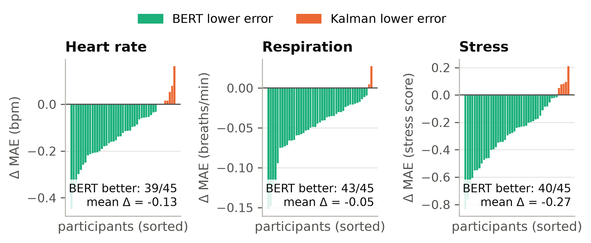

# Mind the Gap

**Imputing short contiguous gaps in physiological sensor time series: linear interpolation vs. Kalman smoothing vs. a pretrained BERT model**

Sara Patano · Elisa Saiz — KTH Royal Institute of Technology, II2202 Research Methodology and Scientific Writing, Autumn 2026

---

Wearable sensors often stop recording for a short time, which leaves short *contiguous* gaps rather than isolated missing values. This repository contains the full experimental pipeline of a study that compares three ways of filling such gaps, under the same protocol:

| Method | Family | What it does |
|---|---|---|
| **Linear interpolation** | Simple interpolation | Draws a straight line between the observed values on each side of the gap |
| **Kalman smoothing** | Statistical time series | Fits a structural state-space model to each window and uses the smoothed level |
| **BERT + LoRA** | Pretrained language model | A frozen `bert-base-uncased` encoder adapted to numerical sequences with Low-Rank Adaptation (0.8% of the parameters trained) |

**Research question:** *How do simple interpolation, statistical time-series, and language-model-based methods compare in imputing missing values within short contiguous gaps in univariate sensor time series?*

## Key results

Out-of-fold test error, mean over 45 participants (5-fold participant-level cross-validation). Lower is better.

| Signal (unit) | Linear | Kalman | BERT | BERT vs. Kalman |
|---|---:|---:|---:|---|
| Heart rate (bpm) | 5.035 | 4.962 | **4.833** | −2.6%, better for 39/45 participants |
| Respiration (breaths/min) | 1.732 | 1.572 | **1.524** | −3.1%, better for 43/45 participants |
| Stress (score, 0–100) | 6.663 | 6.452 | **6.181** | −4.2%, better for 40/45 participants |

- **The ranking is the same for every signal and metric** (MAE and RMSE): BERT < Kalman < linear. All 95% bootstrap confidence intervals for the BERT − Kalman difference lie below zero.
- **The gain is small and costly.** BERT needed about 4.6 GPU hours for the cross-validation; Kalman smoothing took about 4 minutes on a laptop and achieves 36–77% of BERT's improvement over linear interpolation without any training.
- **The results are robust** to using only windows without natural missing values (weaker for stress, where few exist) and to excluding the participants used to develop the BERT training procedure.
- **No method recovers a short peak that falls entirely inside the gap**, so imputed values should be flagged rather than treated as measurements.



*Each bar is one participant; below zero means BERT had the lower error.*

## Experimental design

1. **Data.** Heart rate, respiration and stress series from 45 participants (999 participant-days) of the CSI Balance Challenge, recorded with Garmin vívoactive 5 smartwatches. Heart rate and respiration are sampled every 2 minutes, stress every 3 minutes.
2. **Windows.** Each day is cut into non-overlapping windows of 96 values (3.2 h for heart rate and respiration, 4.8 h for stress).
3. **Artificial gaps.** In each window, 12 contiguous, originally observed values are hidden at a random position (fixed seed), away from the window edges and with an observed value on each side. The hidden values are the ground truth.
4. **Imputation.** All three methods receive exactly the same incomplete windows.
5. **Evaluation.** The mean absolute error (MAE, primary) and root mean squared error (RMSE) are computed on the hidden values and aggregated per participant.

### Participant-level 5-fold cross-validation

```
45 participants ──► 5 folds of 9
for each fold:
    test               9 participants   never used for any choice
    inner validation   7 participants   hyperparameter selection + early stopping
    training          29 participants   model fitting
```

- Every participant is tested exactly once.
- Every method uses the same selection rule: the lowest participant-level MAE on the inner validation participants.
  - Linear interpolation: nothing to select.
  - Kalman smoothing: local level vs. local linear trend.
  - BERT: LoRA learning rate in {1e-4, 2e-4}, plus the best epoch by early stopping.
- That gives 3 signals × 5 folds × 2 learning rates = **30 BERT training runs**.

## Repository structure

```
mind-the-gap-imputation/
├── src/
│   ├── config.py          # all settings: seed, window and gap length, folds
│   ├── load.py            # reads and parses the raw CSV files
│   ├── eda.py             # natural missingness and gap lengths
│   ├── windows.py         # windowing and eligible gap positions
│   ├── make_dataset.py    # windows, fixed masks and participant folds
│   ├── baselines.py       # linear interpolation and Kalman smoothing
│   ├── bert_model.py      # BERT encoder with LoRA adapters and regression head
│   ├── train_bert.py      # cross-validated, resumable BERT training
│   ├── cv.py              # fold and evaluation helpers
│   ├── evaluate.py        # out-of-fold errors, summaries and pairwise comparisons
│   ├── uncertainty.py     # bootstrap confidence intervals over participants
│   └── figures.py         # figures for the report
├── notebooks/
│   ├── colab_train_bert_cv.ipynb   # cross-validated BERT training on a Google Colab GPU
│   └── kaggle_train_bert.ipynb     # early development runs on a fixed split (not used for the results)
├── data/                  # not included (see "Data availability")
├── results/               # tables, figures and BERT run configurations (no predictions)
└── requirements.txt
```

## Reproducing the study

### 1. Setup

```bash
git clone https://github.com/elisasaiz/mind-the-gap-imputation.git
cd mind-the-gap-imputation
python3 -m venv .venv
source .venv/bin/activate
pip install -r requirements.txt
```

### 2. Data

The data are **not included** in this repository. They come from the [CSI Balance Challenge](https://www.kaggle.com/competitions/csi-balance) on Kaggle, which has **restricted access**: to reproduce the study, request access to the competition on Kaggle, download the training files and place them so that they look like this:

```
data/raw/csi-balance/CSV_train/CSV_train/group0/dataset_user_0_train.csv
...
```

The challenge's `x_test.csv` is not used: it has no participant identifier, so it cannot respect the participant-level split.

### 3. Run the pipeline

Run every command from the repository root:

```bash
python -m src.load           # sanity check: loads and parses all files
python -m src.eda            # natural missingness            -> results/eda/
python -m src.make_dataset   # windows, masks and folds       -> data/processed/
python -m src.baselines      # linear + Kalman (~6 min on a laptop)
```

**BERT** needs a GPU. Open `notebooks/colab_train_bert_cv.ipynb` in Google Colab with a T4 runtime and run one cell per signal. Runs are saved to Google Drive and are resumable: finished runs are skipped. Then copy the run folders to `results/cv/bert/` and continue locally:

```bash
python -m src.evaluate       # out-of-fold test errors        -> results/cv/
python -m src.uncertainty    # 95% bootstrap confidence intervals
python -m src.figures        # figures                        -> results/figures/
```

All randomness uses a fixed seed (`SEED = 42` in `src/config.py`), so windows, gaps and folds are identical in every run. The baseline results were reproduced on two computers.

### Output files

| File | Content |
|---|---|
| `results/cv/summary.csv` | Mean, median and standard deviation of participant-level MAE and RMSE |
| `results/cv/participants.csv` | One test error per participant, method and signal |
| `results/cv/pairwise.csv` | Participants for which each method is better and mean paired difference (the file also contains a Wilcoxon *p*-value, which is not used in the report) |
| `results/cv/selections.csv` | Setting selected by each method in each fold |
| `results/cv/uncertainty.csv` | Bootstrap 95% confidence intervals |
| `results/cv/bert/<signal>/fold<k>/lr<rate>/` | Configuration (`run.json`) and training history (`history.csv`) of each of the 30 BERT runs |
| `results/figures/` | Figures in PNG and PDF |

Prediction files (`.npz`) are written locally to `results/cv/predictions/` and `results/cv/bert/`, but are not included in the repository because they contain values from the dataset.

## Environment

| | Versions |
|---|---|
| Data preparation, baselines, evaluation | Python 3.12.5, NumPy 2.5.4, pandas 3.0.6, SciPy 1.18.1, statsmodels 0.15.0, Matplotlib 3.11.2 |
| BERT (Google Colab, NVIDIA T4) | Python 3.13.16, PyTorch 2.14.1 (CUDA 13.0), Transformers 5.22.1, PEFT 0.21.2 |

## Limitations

- One dataset, one device type, one gap length (12 values) and one random gap position per window.
- Each BERT configuration was trained once per fold, with one seed.
- One representative method per family. The results do not cover every statistical or language-model-based approach.

## Data availability and ethics

The dataset is **not** redistributed in this repository. It contains pseudonymised physiological recordings, which are health data under the GDPR. Participant identifiers were used only to keep participants separate across folds, and no attempt was made to identify individuals. Raw data, processed windows and prediction files are excluded from version control (see `.gitignore`). Access to the data must be requested through the CSI Balance Challenge on Kaggle.

## Use of AI tools

Generative AI assistants (Claude, ChatGPT, Gemini) were used, among other things, to draft and debug code. All code was reviewed, run and tested by the authors, and the results were reproduced independently on two computers. The final report explains in detail how the assistant was used and how its output was verified.

## Citation

```bibtex
@techreport{patano_saiz_2026_mindthegap,
  author      = {Patano, Sara and Saiz, Elisa},
  title       = {Mind the Gap: Imputing Short Contiguous Gaps in Physiological Sensor Time Series},
  institution = {KTH Royal Institute of Technology},
  type        = {Course project report, II2202},
  year        = {2026}
}
```
